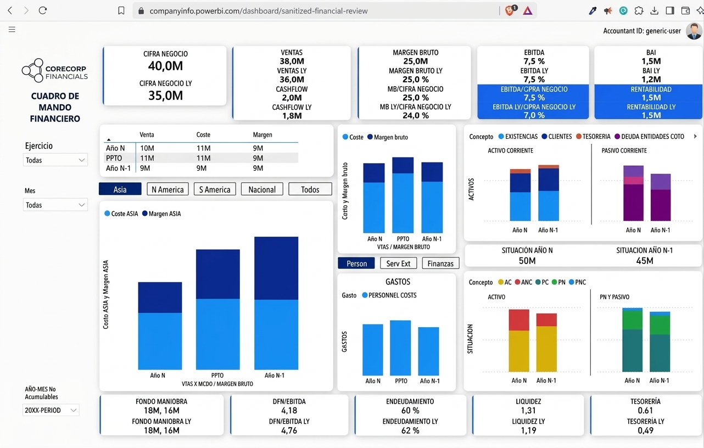
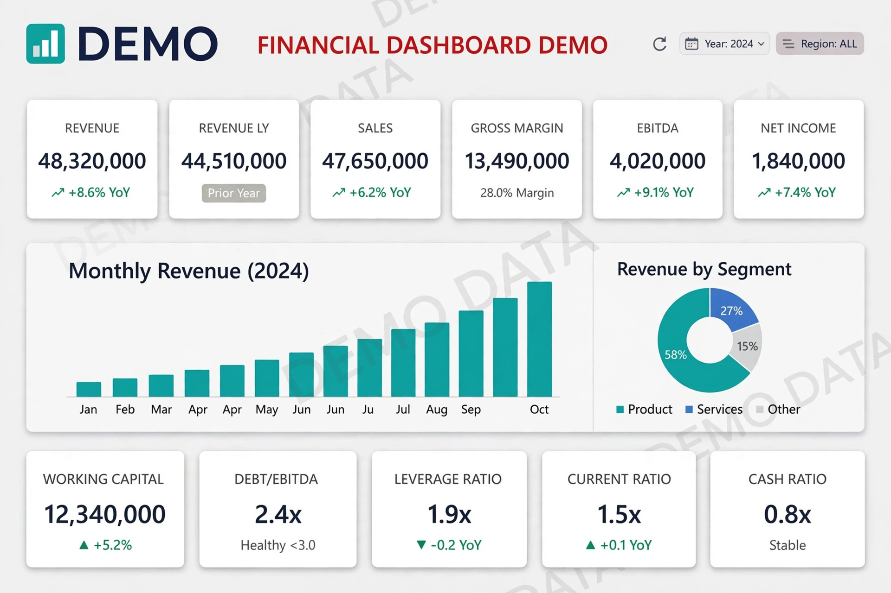
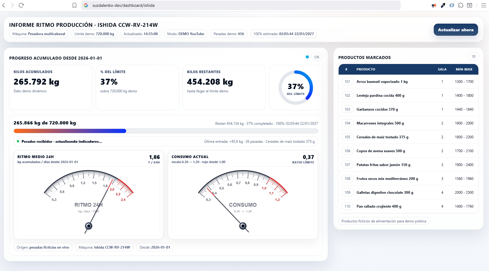

### Demo Resumen Financiero

### Desglose de tiempos y ritmos de producción (Análisis de tiempos y capacidad de línea)

### Demo ritmo de producción industrial en tiempo real

 
 
 

### Demo monitor de Ritmo de Producción

 
 
 

### Demo dashboard de control de gasto de máquinas

 
 
 

### DEMO MES

Building real-time industrial dashboards, production monitoring systems, Power BI analytics, and backend automations for manufacturing companies.
